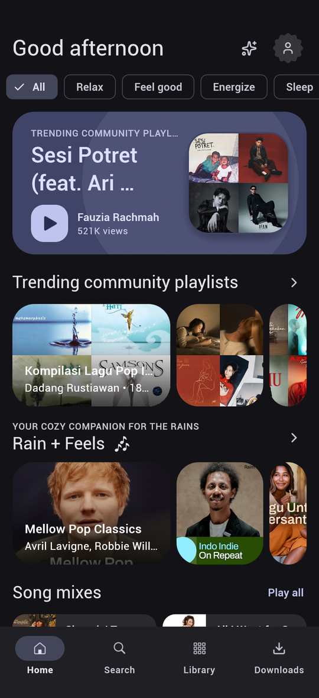
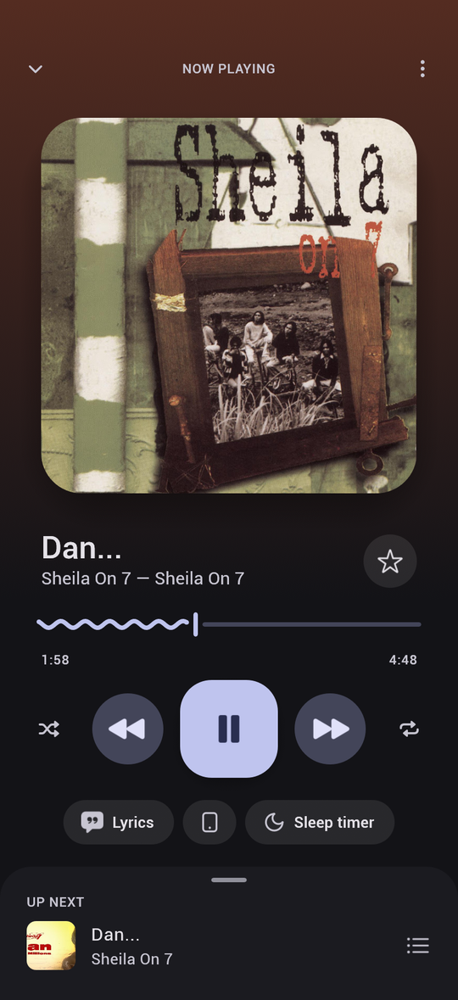
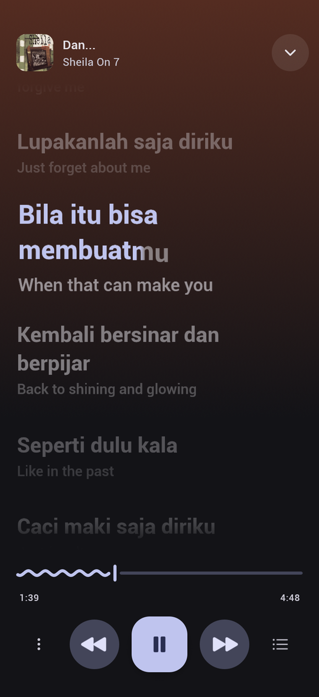

<div align="center">
  <h1>Aoto</h1>
  <p><strong>A fast, native YouTube Music player for Android, written in Rust.</strong></p>
  <p>藍音 (あおと): “indigo sound”. Material You on the outside, a native audio engine on the inside. No embedded browser player.</p>
</div>

> [!IMPORTANT]
> Aoto is not affiliated with, endorsed by, or connected to YouTube, Google or Apple.
> Use it at your own discretion.

## Screenshots

<table>
  <tr>
    <td width="33%"></td>
    <td width="33%"></td>
    <td width="33%"></td>
  </tr>
  <tr>
    <td align="center"><b>Home</b></td>
    <td align="center"><b>Now Playing</b></td>
    <td align="center"><b>Lyrics</b></td>
  </tr>
</table>

## Features

**Playback**
- **YouTube Music, natively**: search, browse, albums, playlists, artist pages, radio, mixes, charts and your library.
- **Lossless / Hi-Res / Dolby Atmos** from configured addon sources when a matching copy exists, with YouTube audio as the fallback. You choose when an addon's copy may play (always, Wi-Fi only, off), and `addons/flac-library` is a small addon server for your own FLAC files, with a guide for writing others.
- **Stream quality** (Low, Normal, High) chosen separately for Wi-Fi and for mobile data.
- **Gapless playback, crossfade and Automix** between songs.
- **Playback speed** from 0.5× to 2×, with or without keeping the pitch.
- **Equalizer**: seven bands, presets and a bass boost, plus volume normalization and spatial audio for headphones, in three strengths.
- **Sleep timer**: after a time, at the end of the song or of the queue, with a fade-out.
- **Play on**: names where the sound goes and opens Android's own output switcher.
- **Audio info**: the path from the file to your ears, stage by stage (track, decoder, sound, resampling, output).

**Lyrics**
- Timed, word-by-word lyrics from several providers, with romanization and translation.
- **Lyric cards**: pick up to four lines and save or share them as a picture.

**Your music**
- **Downloads** for offline playback, including a whole album or playlist at once, on Wi-Fi only if you like. They can be saved as the addon's **FLAC** copy with tags, cover and lyrics, downloaded playlists keep up with new songs, and a download can be removed from the menu.
- **Music on your phone**: add folders and play what is in them (FLAC, ALAC, WAV, AIFF, AAC, MP3, OGG Vorbis), each labelled as what it really is.
- **Listening stats**, kept on the device only.
- **Last.fm** scrobbling, **Listen together** sessions, and **Spotify transfer** for bringing playlists over.

**Android**
- Material You throughout (with an optional pure black theme), a second theme (**Sticker**: outlined pastel cards, light and dark), a choice of five app icons, a media notification, home-screen widgets (4×2, 2×2 and 4×1) and Android Auto.
- **Update notifications**: a newer release is announced, and installs over the old one without uninstalling.

## Status

Aoto 1.0.0 is the first release under this name. Much of what is above was built and tested on a desktop preview and with automated tests; the Android-only parts (widgets, Android Auto, Play on, saving and sharing lyric cards) have not been tried on many devices yet. Please report what breaks.

## Building

You need the [Rust toolchain](https://rustup.rs/), the Android SDK and NDK, [`cargo-ndk`](https://github.com/bbqsrc/cargo-ndk) and the Android target (`rustup target add aarch64-linux-android`).

```sh
sh android/build.sh      # builds the debug APK
cargo test               # the tests run on the host
sh android/test-java.sh  # the plain-Java checks
```

The APK ends up in `android/app/build/outputs/apk/debug/`. Read `android/build.sh` for the environment it expects.

## Thanks

Aoto is built on **BitChord** ([kushagrasinghx/BitChord](https://github.com/kushagrasinghx/BitChord)) and on its Rust rewrite, **BitChord PC Official** ([jackychan4891/BitChord-PC-Official](https://github.com/jackychan4891/BitChord-PC-Official)) and its contributors. The player, the sources it plays from, the lyrics and much of the interface come from their work. Thank you.

## Notes

- Audio and the interface are native (Rust, egui and rodio). Signing in and some web flows use an Android WebView.
- Hi-Res, Lossless and Atmos playback depends on the addon sources you configure and on a matching, playable copy existing for the song.
- Aoto does not bypass subscriptions, DRM or regional restrictions. What is available depends on the services you use.
- Third-party services (YouTube Music, lyrics providers, Last.fm, Spotify, addon sources) can change their behaviour over time.

## License

[GPL-3.0](LICENSE), the same as the projects it is built on. Bug reports and pull requests are welcome; please include your Android version and device, and remove any secrets from logs.
